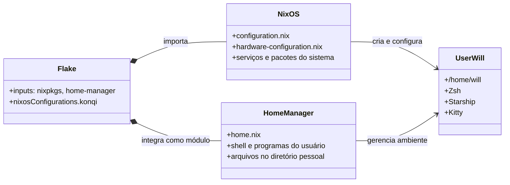
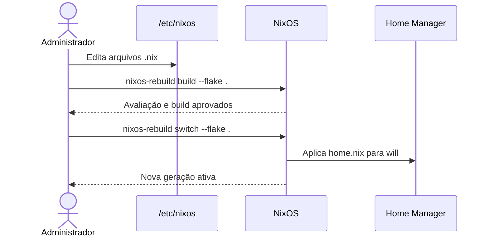

# Configuração NixOS do `konqi`

Configuração declarativa do host **konqi**, baseada em NixOS, Flakes e Home
Manager. O repositório é a fonte de verdade para o sistema operacional e para
o ambiente do usuário `will`.

Versão 1.5.4

| Propriedade | Valor |
| --- | --- |
| Host | `konqi` |
| Arquitetura | `x86_64-linux` |
| Canal | `nixos-unstable` |
| Localidade | `pt_BR.UTF-8` |
| Fuso horário | `America/Sao_Paulo` |
| Ambiente gráfico | KDE Plasma 6 com SDDM |

## Arquitetura



O Home Manager é aplicado dentro do mesmo `nixos-rebuild`; não é necessário
executar `home-manager switch` separadamente.

## Estrutura do repositório

| Arquivo | Responsabilidade | Regra de alteração |
| --- | --- | --- |
| `flake.nix` | Entradas, versões e saída `nixosConfigurations.konqi`. Integra o Home Manager. | Altere ao adicionar ou atualizar dependências e módulos. |
| `flake.lock` | Versões exatas das entradas do flake. | Versione toda alteração gerada por `nix flake update`. |
| `configuration.nix` | Opções de sistema, serviços, usuário, rede e pacotes globais. | Use para recursos necessários ao host ou a todos os usuários. |
| `home.nix` | Ambiente declarativo do usuário `will`. | Use para preferências e programas de uso pessoal. |
| `hardware-configuration.nix` | Discos, módulos de kernel e parâmetros detectados. | Não edite manualmente; regenere apenas após mudança de hardware. |

## Recursos administrados

### Sistema

- Inicialização EFI com `systemd-boot` e kernel `linuxPackages_latest`.
- NetworkManager, Wi-Fi, CUPS, PipeWire e `rtkit`.
- KDE Plasma 6, SDDM, teclado ABNT2/ThinkPad e console brasileiro.
- Autenticação biométrica para login, SDDM e `sudo`.
- Firefox, OpenSSH, Tailscale e agente GnuPG com suporte a SSH.
- Recursos experimentais Nix: `nix-command` e `flakes`.

### Usuário `will`

- Zsh como shell padrão, com autosuggestions e syntax highlighting.
- Prompt Starship e terminal Kitty com JetBrains Mono Nerd Font.
- Aliases: `rebuild`, `update`, `nixcode` e `ll`.
- Ferramentas de desenvolvimento, terminal e desktop, incluindo Git, Node.js,
  Python, GCC, Rustup, Bun, Neovim, VS Code, tmux e LibreOffice.

## IA local com llama.cpp

[`llama.cpp`](https://github.com/ggml-org/llama.cpp) é um runtime de inferência
para executar modelos de linguagem localmente. Ele carrega modelos no formato
GGUF, que podem ser quantizados para reduzir o uso de memória, e oferece o
`llama-server`, um servidor HTTP que recebe prompts e devolve texto gerado.
O projeto suporta diferentes hardwares e backends; neste setup, o pacote
`pkgs.llama-cpp` é usado na configuração CPU do nixpkgs.

O plugin [`llama.vim`](https://github.com/ggml-org/llama.vim) integra o editor
ao servidor: pode solicitar sugestões de código com contexto antes e depois do
cursor (Fill-in-the-Middle, ou FIM) e edição baseada em instruções. No Micro, o
plugin local descrito abaixo usa diretamente a API HTTP do `llama-server`. O
fluxo é:

```text
Micro -> llama-server em 127.0.0.1 -> modelo GGUF -> resposta ao editor
```

### O que esta configuração prepara

O módulo `llama-cpp-nvim.nix`, importado e habilitado por `home.nix`:

- Instala `llama.cpp` e cria o wrapper
  `~/.local/share/llama-cpp/bin/llama-server`, que encaminha os argumentos ao
  binário do nixpkgs.
- Instala uma versão fixada do plugin `llama.vim` em
  `~/.local/share/nvim/site/pack/ia/opt/llama.vim`.
- Durante a ativação do Home Manager, baixa o modelo GGUF de código que ainda
  faltar. Na primeira vez, é necessário ter internet; o arquivo ocupa cerca de
  1,6 GB. Depois de baixado, o modelo pode ser usado sem rede.

Os modelos são armazenados em `~/.local/share/llama-cpp/models/`:

| Modelo | Caminho | Uso previsto |
| --- | --- | --- |
| Qwen2.5-Coder 1.5B Q8_0 | `qwen2.5-coder-1.5b-q8_0.gguf` | Sugestões FIM e chat local no Micro |

Q8_0 é a quantização de 8 bits deste modelo. O serviço local usa esse mesmo
GGUF para FIM e chat, evitando carregar dois modelos simultaneamente.

### Estado da integração neste repositório

O módulo `llama-cpp-nvim.nix` instala o servidor local, o modelo, o plugin
`llama.vim`, o cliente de chat do Micro e o comando de terminal `nixai`. Micro,
Neovim e `nixai` usam o mesmo servidor e modelo local. As perguntas e o código
enviados a esse serviço ficam na máquina.

### Integração no Micro

Ao ativar `programs.llama-cpp-nvim`, o Home Manager instala um plugin Lua do
Micro, um pequeno cliente HTTP baseado em `curl` e `jq`, e um serviço de usuário
que inicia o `llama-server` automaticamente. O servidor usa o modelo
Qwen2.5-Coder 1.5B Q8_0 e escuta somente em `127.0.0.1:9931`; o código e as
perguntas enviados pelo editor não saem da máquina. A política CORS também é
limitada a origens locais.

| Atalho | Ação |
| --- | --- |
| Após 700 ms sem digitar | Solicita uma sugestão de código em segundo plano; a prévia aparece na barra de informações. |
| `Tab` | Aceita a sugestão pronta; sem sugestão, mantém o autocomplete/indentação padrão do Micro. |
| `F4` | Solicita uma sugestão imediatamente para o ponto do cursor. |
| `F8` | Abre o campo de comando do Micro; digite a pergunta e pressione `Enter`. A conversa aparece em uma divisão e mantém o histórico durante a sessão do editor. |

O plugin solicita sugestões automaticamente após 700 ms sem digitação e descarta
a resposta se o texto ao redor do cursor mudar durante a geração. Como o Micro
não oferece aos plugins Lua uma API de texto fantasma inline, a sugestão aparece
na barra de informações e é aceita com `Tab`. `F4` substitui a ação padrão de
sair associada à tecla no Micro. Para testar se o terminal envia teclas de
função ao editor, use `> raw` no Micro.

Para conversar, pressione `F8`, digite `llama-chat sua pergunta` e pressione
`Enter`. O Micro abre uma divisão para a conversa e mantém o histórico enquanto
essa sessão do editor estiver aberta.

### Integração no Neovim

O `llama.vim` é carregado pelo `initLua` e solicita sugestões FIM ao servidor
local após uma pausa ao digitar. O autocomplete LSP/buffer do `nvim-cmp` continua
disponível junto com as sugestões da IA.

| Atalho/comando | Ação |
| --- | --- |
| `F4` | Alterna o autocomplete automático da IA. Mostra `online` ou `off` por 10 segundos; cada toque alterna o estado e reinicia o temporizador. |
| `Tab` | Aceita a sugestão da IA quando há texto fantasma visível; caso contrário, seleciona o próximo item do `nvim-cmp`. |
| `Shift+Tab` | Aceita somente a primeira linha da sugestão da IA; sem sugestão, seleciona o item anterior do `nvim-cmp`. |
| `F8` | Abre o campo de pergunta do chat local. A conversa aparece em uma divisão e mantém o histórico durante a sessão do Neovim. |
| `:LlamaChat` | Abre o mesmo campo de pergunta do `F8`. Também aceita uma pergunta diretamente, por exemplo `:LlamaChat explique esta função`. |

O estado `online` no aviso do `F4` significa que as sugestões automáticas estão
ativadas; não é uma verificação de conectividade do servidor. O `F8` e o comando
`:LlamaChat` enviam as mensagens para o endpoint local de chat e mostram as
respostas no painel dedicado.

### Chat no terminal

O comando `nixai` inicia uma conversa interativa no terminal, usando o mesmo
servidor e modelo. Durante cada solicitação, uma animação mostra que a IA está
pensando; a resposta aparece quando a geração termina. O histórico é mantido
durante a execução do comando, e a orientação inicial pede respostas diretas em
português do Brasil, sem repetir a pergunta.

```bash
nixai
```

Digite uma pergunta no prompt `Você:`. Também é possível iniciar com uma pergunta
na linha de comando; o programa responde e continua aberto para as próximas:

```bash
nixai "Como encontro arquivos maiores que 10 MB?"
```

Digite `/sair` para terminar. `/exit` e `/quit` também encerram a conversa.
O comando é instalado pelo Home Manager quando a configuração é aplicada.

### Serviço e diagnóstico

O servidor e o cliente podem ser conferidos com:

```bash
systemctl --user status llama-micro-server
curl -fsS http://127.0.0.1:9931/health
```

### Benchmark neste computador

Medição local com `llama-bench`, pacote llama.cpp 0.5.0, backend CPU/BLAS,
Intel Core i5-8365U (4 núcleos/8 threads), 16 GiB de RAM e Intel UHD 620
integrada. A configuração Nix usa CPU, não descarrega camadas para a GPU. O
teste processou um prompt de 256 tokens e gerou 64 tokens:

| Modelo / threads | Prompt (tokens/s) | Geração (tokens/s) |
| --- | ---: | ---: |
| Qwen2.5-Coder 1.5B Q8_0, 4 threads | 16,90 ± 1,16 | 4,56 ± 0,08 |
| Qwen2.5-Coder 1.5B Q8_0, 8 threads | 11,74 ± 0,37 | 2,13 ± 0,04 |

Para este processador móvel, 4 threads foram mais rápidas e deixam recursos
livres para o editor e o sistema. O modelo ocupa cerca de 1,53 GiB em disco;
durante a inferência há também memória de contexto e buffers. Por isso, o
mesmo modelo é usado para F4 e F8 em vez de manter dois modelos carregados.

O arquivo Qwen3 4B Instruct Q4_K_M encontrado em `models/chat/` falhou na
validação do GGUF (`tensor ... data is not within the file bounds`), então não
foi possível medi-lo. A ativação não o baixa mais automaticamente e não apaga
o arquivo existente. O modelo selecionado é menor, mas a qualidade de chat e
código é inferior à de modelos maiores.

O benchmark pode ser repetido com:

```bash
llama-bench -m ~/.local/share/llama-cpp/models/qwen2.5-coder-1.5b-q8_0.gguf -t 4 -p 256 -n 64 -r 3
```

Para aplicar o módulo e baixar os modelos, execute o rebuild habitual:

```bash
sudo nixos-rebuild switch --flake /etc/nixos#konqi
```

Consulte a documentação oficial de [llama.cpp](https://github.com/ggml-org/llama.cpp)
e [llama.vim](https://github.com/ggml-org/llama.vim) para detalhes de servidor,
opções de inferência e configuração do plugin.

## Editor: micro com LSP

O `micro` é configurado declarativamente pelo `programs.micro` em
`home.nix`. O suporte a autocomplete, definição, referências, assinatura de
funções, formatação e diagnósticos é fornecido pelo plugin
[micro-plugin-lsp](https://github.com/AndCake/micro-plugin-lsp).

### Configuração declarativa (`home.nix`)

```nix
programs.micro = {
  enable = true;
  settings = {
   colorscheme = "monokai";
   tabsize = 4;
   tabstospaces = true;
   autoindent = true;
   syntax = true;
   ruler = true;
   softwrap = false;
   scrollbar = true;
   statusline = true;
   mouse = true;
   clipboard = "external";

   "lsp.server" = "c++=clangd,c=clangd,python=pyright-langserver --stdio,sh=bash-language-server start,rust=rust-analyzer";
   "lsp.formatOnSave" = true;
   "lsp.autocomplete" = true;
   "lsp.diagnostics" = true;
  };
};
```

### Servidores de linguagem no sistema

Os servidores precisam estar no `$PATH` global. Declarar um servidor apenas em
`programs.neovim.extraPackages` o torna disponível somente para o wrapper do
Neovim, e não para outros programas, como o `micro`.

Em `configuration.nix`, mantenha os pacotes necessários em
`environment.systemPackages`:

```nix
environment.systemPackages = with pkgs; [
  clang-tools           # clangd, clang-format e clang-tidy
  pyright
  bash-language-server
  rust-analyzer
];
```

Depois, aplique a configuração:

```bash
rebuild
```

### Instalação única do plugin

O Home Manager não possui uma opção nativa para administrar plugins do
`micro`. Por isso, instale o plugin uma vez por máquina:

```bash
micro -plugin install lsp
```

Para reinstalar ou redefinir o plugin:

```bash
rm -rf ~/.config/micro/plug/lsp
micro -plugin install lsp
```

### Sintaxe de `lsp.server`

O valor usa o formato `<tipo-de-arquivo>=<comando>`, com entradas separadas por
vírgulas. Não use `:` ou `|` como separadores:

```text
c++=clangd,c=clangd,python=pyright-langserver --stdio,sh=bash-language-server start,rust=rust-analyzer
```

### Atalhos gerais

| Atalho | Ação |
| --- | --- |
| `Ctrl+S` | Salvar |
| `Ctrl+Q` | Sair |
| `Ctrl+E` | Abrir a barra de comandos |
| `Ctrl+Z` | Desfazer |
| `Ctrl+Y` | Refazer |
| `Ctrl+F` | Buscar |
| `Ctrl+N` | Próximo resultado |
| `Ctrl+P` | Resultado anterior |
| `Ctrl+G` | Abrir a ajuda |
| `Ctrl+C` | Copiar |
| `Ctrl+V` | Colar |
| `Ctrl+X` | Recortar |
| `Ctrl+A` | Selecionar tudo |
| `Ctrl+D` | Duplicar linha |
| `Ctrl+K` | Recortar linha inteira |

### Navegação

| Atalho | Ação |
| --- | --- |
| `Ctrl+←` / `Ctrl+→` | Avançar ou voltar uma palavra |
| `Ctrl+Home` / `Ctrl+End` | Ir para o início ou fim do arquivo |
| `Alt+←` / `Alt+→` | Recuar ou indentar a linha |
| `Alt+↑` / `Alt+↓` | Mover a linha para cima ou para baixo |

### Múltiplos cursores e seleção

| Atalho | Ação |
| --- | --- |
| `Alt+N` | Adicionar a próxima ocorrência à seleção |
| `Ctrl+Alt+↑` / `Ctrl+Alt+↓` | Adicionar cursor acima ou abaixo |
| `Esc` | Limpar múltiplos cursores |

### Abas e divisões

| Atalho | Ação |
| --- | --- |
| `Ctrl+T` | Nova aba |
| `Alt+,` / `Alt+.` | Aba anterior ou próxima |
| `Ctrl+W` | Divisão vertical |
| `Ctrl+U` | Divisão horizontal |

### Atalhos do LSP

Esses atalhos exigem que um servidor de linguagem esteja em execução:

| Atalho | Ação |
| --- | --- |
| `Ctrl+Space` | Forçar autocomplete |
| `Alt+D` | Ir para a definição |
| `Alt+K` | Exibir assinatura da função |
| `Alt+R` | Listar referências |

### Referência da barra de comandos

Pressione `Ctrl+E` e use um dos comandos abaixo:

| Comando | Ação |
| --- | --- |
| `log` | Exibir o log interno de diagnóstico |
| `plugin list` | Listar plugins instalados e seus status |
| `plugin on <nome>` | Ativar um plugin |
| `plugin off <nome>` | Desativar um plugin |
| `filetype` | Exibir o tipo de arquivo detectado |
| `set <opção> <valor>` | Alterar uma configuração temporariamente |

### Diagnóstico

Se o autocomplete não aparecer, verifique:

1. Se o servidor está no `$PATH`:

  ```bash
  which clangd
  ```

2. Se o plugin está instalado:

  ```bash
  ls -la ~/.config/micro/plug/lsp/
  ```

3. Se há um processo do servidor em execução com um arquivo aberto:

  ```bash
  ps aux | grep clangd
  ```

4. Se a sintaxe de LSP está correta no arquivo de configurações:

  ```bash
  cat ~/.config/micro/settings.json | grep lsp
  ```

5. Se o `home.nix` contém a configuração aplicada:

  ```bash
  grep -A 2 "lsp.server" /etc/nixos/home.nix
  ```

6. Consulte o log interno pelo editor: `Ctrl+E` → `log`.
7. Force o autocomplete manualmente com `Ctrl+Space`.

> **Causa comum:** servidores declarados apenas em `programs.neovim.extraPackages`
> ficam restritos ao ambiente do Neovim. Para que o `micro` e outros programas
> os encontrem, declare-os também em `environment.systemPackages`.

## Operação diária

Execute os comandos a partir de `/etc/nixos` ou informe explicitamente o
caminho do flake.

### Validar antes de aplicar

```bash
sudo nixos-rebuild build --flake /etc/nixos#konqi
```

Esse comando avalia e constrói a nova geração, mas não a ativa.

### Aplicar a configuração

```bash
sudo nixos-rebuild switch --flake /etc/nixos#konqi
```

O `switch` ativa uma nova geração. Se a avaliação ou a construção falhar, a
geração em execução não é modificada.

### Fluxo de mudança



## Atualização de dependências

```bash
cd /etc/nixos
sudo nix flake update
sudo nixos-rebuild build --flake .#konqi
sudo nixos-rebuild switch --flake .#konqi
```

Revise o diff de `flake.lock` antes do commit. Como o projeto acompanha
`nixos-unstable`, atualizações podem introduzir versões novas de pacotes ou
opções incompatíveis.

## Recuperação

O NixOS preserva gerações anteriores. Caso uma geração recém-aplicada apresente
problemas, selecione uma geração anterior no menu do `systemd-boot` durante a
inicialização. Depois de iniciar nela, corrija a configuração e aplique um novo
rebuild.

Para listar as gerações disponíveis:

```bash
sudo nixos-rebuild list-generations
```

## Home Manager e backups

Ao precisar substituir um arquivo existente em `/home/will`, o Home Manager
preserva a cópia anterior com a extensão `.hm-backup`. Revise ou remova esses
arquivos somente após confirmar que a configuração nova está correta.

## Convenções de manutenção

- Mantenha `system.stateVersion` e `home.stateVersion` nos valores de criação;
  eles não determinam a versão para a qual o sistema será atualizado.
- Use `nix fmt` quando houver um formatador configurado para o flake e sempre
  confirme o resultado com `git diff --check`.
- Antes do rebuild, revise `git diff`; após uma mudança validada, registre os
  arquivos `.nix` e, se aplicável, o `flake.lock` no mesmo commit.
- Não armazene senhas, chaves privadas ou tokens neste repositório. Para
  segredos, adote uma solução própria de gerenciamento de segredos antes de
  declará-los na configuração.
